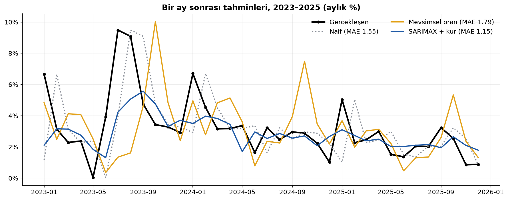
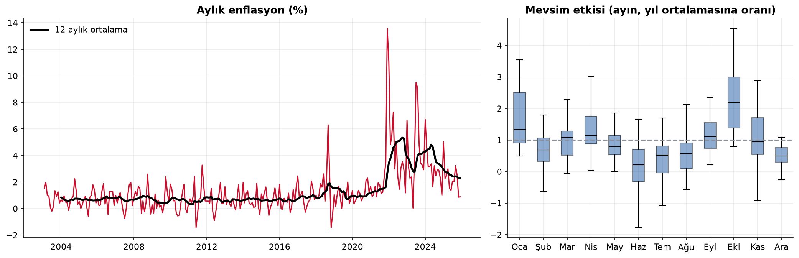
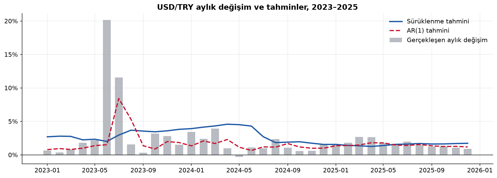
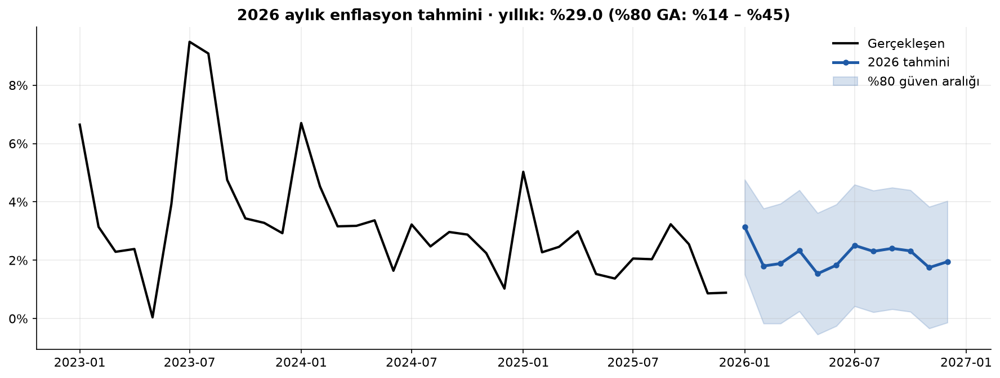

# 🔮 Türkiye'de Aylık Enflasyon Tahmini


Türkiye'nin aylık enflasyonunu zaman serisi modelleriyle tahmin eden ve modelleri **gelecekten bilgi sızdırmadan** basit kurallarla yarıştıran bir çalışma. Ek olarak kur geçişkenliğini ölçüyor ve USD/TRY'nin tahmin edilip edilemeyeceğini sınıyor.

📓 **Analizin tamamı:** [`analiz.ipynb`](analiz.ipynb)

## Sonuçlar

| | Sonuç |
|---|---|
| En iyi enflasyon modeli | **SARIMAX + kur**: ortalama hata 1,15 puan, naif tahmine göre **%26 daha iyi** |
| Kur geçişkenliği | USD/TRY'de %10 artış → ertesi ay enflasyonda **≈ +1,5 puan** |
| Kur tahmini | AR(1), rastgele yürüyüşe göre **%44 daha az hata** |
| 2026 yıllık enflasyon tahmini | **%29** (%80 güven aralığı: %14 – %45) |

### 36 aylık geriye dönük test (2023–2025)


| Yöntem | MAE (puan) | Naife göre |
|---|---|---|
| **SARIMAX + kur** | **1,15** | **0,74** |
| SARIMA | 1,25 | 0,81 |
| 12 ay ortalaması | 1,48 | 0,96 |
| Naif (geçen ay) | 1,55 | 1,00 |
| Mevsimsel oran | 1,79 | 1,16 |

### Mevsimsellik: Ocak ve Ekim yüksek, yaz ayları düşük


### Kur tahmin edilebilir mi?
Meese ve Rogoff'un (1983) klasik bulgusuna göre kurları tahmin etmede "gelecek ay = bu ay" kuralını yenmek zordur. 2023–2025'te TL kontrollü bir hızla değer kaybettiği için bu bulgu geçerli değil.



### 2026 tahmini


## Yöntem

- **Hedef:** aylık enflasyon $\pi_t = 100 \cdot (P_t / P_{t-1} - 1)$
- **SARIMA** $(1,0,1)\times(1,0,1)_{12}$: kısa dönem dinamik + 12 ay önceki aynı ayın etkisi
- **SARIMAX:** SARIMA + geçen ayın USD/TRY değişimi (dışsal değişken)
- **Genişleyen pencere ile değerlendirme:** Her test ayında model yalnızca o aya kadarki veriyle yeniden kurulur ve bir ay sonrasını tahmin eder.
- **Yıllık tahmin:** 12 aylık tahminlerin bileşik çarpımı; güven aralığı 2.000 simülasyondan.

$$\pi_{yıllık} = \prod_{k=1}^{12} \left(1 + \frac{\hat\pi_k}{100}\right) - 1$$

## Veri

| Veri | Kaynak |
|---|---|
| Aylık TÜFE endeksi (2003–2025) | [OECD Data Explorer](https://data-explorer.oecd.org/), Consumer Price Indices |
| Aylık ortalama USD/TRY | [Frankfurter](https://frankfurter.dev) (Avrupa Merkez Bankası referans kurları) |

## Çalıştırma

```bash
pip install -r requirements.txt
python -m src.veri           # (isteğe bağlı) veriyi yeniden çeker
jupyter notebook analiz.ipynb
```

## Sınırlılıklar

- Para politikası, vergi düzenlemeleri ve yönetilen fiyatlar modelde yok; şoklar tahmin edilemiyor.
- Veri Aralık 2025'te bitiyor. 2026 tahmini, gerçek veriler yayımlandıkça sınanabilir.

> ⚠️ Eğitim amaçlıdır, ekonomik tahmin ya da yatırım tavsiyesi değildir.

İlgili proje: [enflasyon-doviz-analizi](https://github.com/mehmet-vural/enflasyon-doviz-analizi): 20 yıllık enflasyon, kur ve satın alma gücü paritesi.

---

**Mehmet Vural** · Matematik Öğretmeni · Veri Bilimi & Finans · [LinkedIn](https://www.linkedin.com/in/mehmetvrl/)
